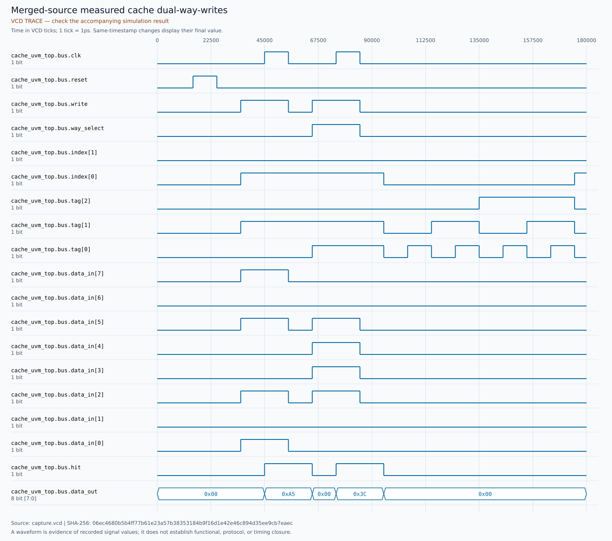
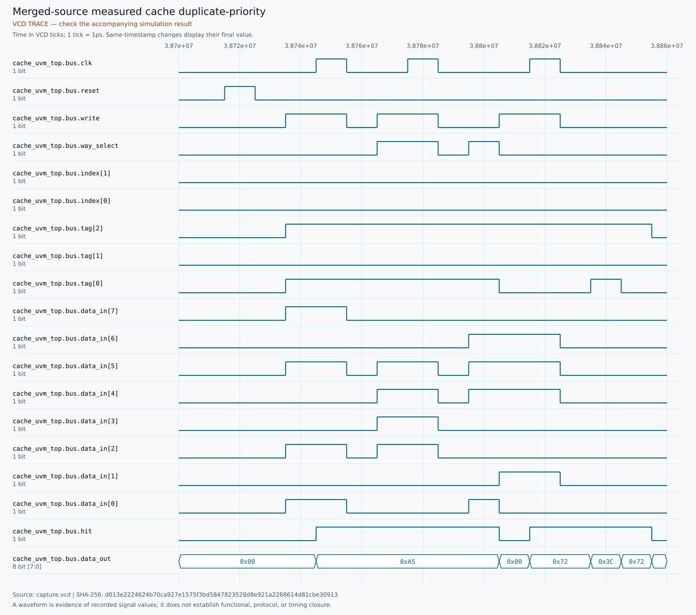
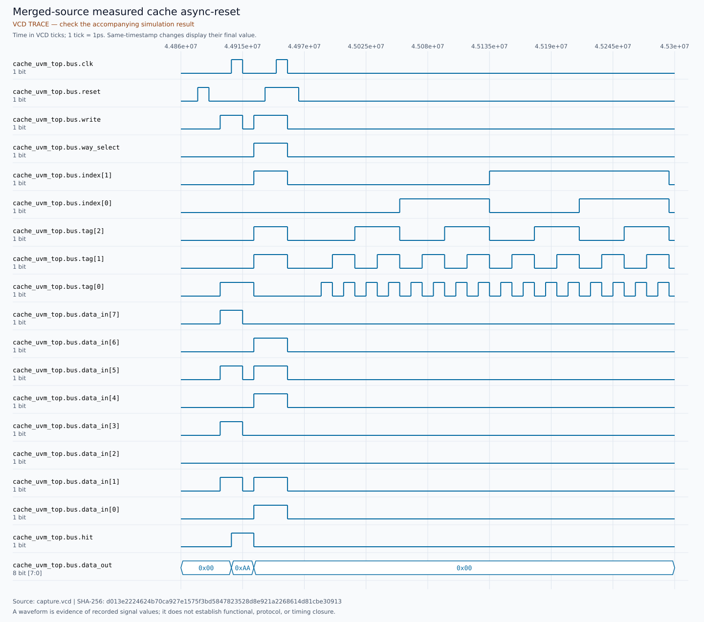
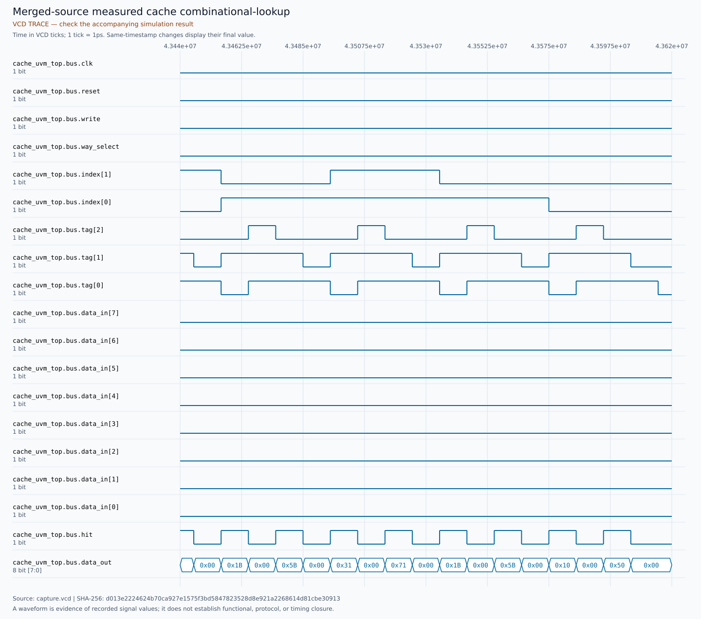

# Deterministic cache UVM/SVA merged-source closeout

**PASS: 20/20 named required substeps; aggregate and actual outer wrapper exit 0.**
Executed 10 November 2026 with serial simulator sessions from a fresh normal
GitHub clone, explicitly detached at the actual AMBA merge. No implementation
or DUT correction was needed during closeout.

## Reviewed merges and tested identities

| Item | Exact identity |
| --- | --- |
| [AMBA PR #16](https://github.com/M-Roohan-Khan-28/AMBA-Protocol-Verification/pull/16) reviewed head | `676a8b4ab0c128e1bfd6776198734b0810bc7adf` |
| Actual AMBA merge / tested environment | `b9c35a85113c99715ede572ab1f5dd94574b23e6` |
| [Cache documentation PR #3](https://github.com/M-Roohan-Khan-28/Two-Way-Cache-RTL/pull/3) reviewed head | `529c4f7daf60d566f3f45631b5a6bf4d3bc006e6` |
| Actual cache documentation merge | `b96e33907c8e33e37aa7ce17d912f67bec5e4b9a` |
| Qualified implementation; runner and inventory last-change | `9c74c35e0c2616a09af8824d2d85754738b5303a` |
| DUT lock and observed detached DUT revision | `b6246eff1380aa0fb7812de9fccaf12b849fa1ca` |

Owner CLI/API verified `M-Roohan-Khan-28`, immutable ID `270144410`.
Both PRs were open/non-draft/mergeable, with matching reviewed heads/bases,
no review discussions or required checks/branch rules blocking the merge.
GitHub returned completed normal merge commits under explicit head-SHA guards.
The review authorization came from the owner; no GitHub approval review is
invented. No force push or protection bypass occurred.

All **12 execution-input hashes** match the qualified implementation, merged
Git blobs and clean detached checkout. The DUT execution-file hashes also
match. Both worktrees stayed clean after execution. [Source locks and tool
fingerprints](SOURCE_LOCKS.json), [merge/clone receipts](source-receipts/fresh-clone.json),
[validation](VALIDATION.json) and [raw results](run/results.json) are separate
from the unchanged earlier publication at
[review head 676a8b4](https://github.com/M-Roohan-Khan-28/AMBA-Protocol-Verification/blob/676a8b4ab0c128e1bfd6776198734b0810bc7adf/reports/cache-uvm-2026-11-10/SUMMARY.md).

## Complete named inventory

| Required substep | Actual result | Interpretation |
| --- | --- | --- |
| `runner-qualification` | PASS | SYNTHETIC_RECORD_FIXTURES |
| `sva-reset` | PASS | EXECUTED |
| `sva-write` | PASS | EXECUTED |
| `sva-hit` | PASS | EXECUTED |
| `sva-miss` | PASS | EXECUTED |
| `sva-stored` | PASS | EXECUTED |
| `sva-duplicate` | PASS | EXECUTED |
| `sva-legal` | PASS | EXECUTED |
| `smoke` | PASS | EXECUTED |
| `functional` | PASS | EXECUTED |
| `fault-wrong_way` | PASS | EXPECTED_CHILD_FAILURE |
| `fault-wrong_set` | PASS | EXPECTED_CHILD_FAILURE |
| `fault-wrong_tag` | PASS | EXPECTED_CHILD_FAILURE |
| `fault-corrupted_data` | PASS | EXPECTED_CHILD_FAILURE |
| `fault-wrong_priority` | PASS | EXPECTED_CHILD_FAILURE |
| `fault-false_hit` | PASS | EXPECTED_CHILD_FAILURE |
| `fault-missing_reset` | PASS | EXPECTED_CHILD_FAILURE |
| `fault-forbidden_reset_write` | PASS | EXPECTED_CHILD_FAILURE |
| `fault-missing_marker` | PASS | EXPECTED_CHILD_FAILURE |
| `portable` | PASS | EXECUTED |

The runner qualification passed **27 synthetic record fixtures**. Those
fixtures test validation decisions on altered records; they are not induced
simulator crashes. Six reset-isolated negative SVA controls each detected
the intended identifier: `RESET_DOMINANCE`, `SELECTED_WRITE`, `LOOKUP_HIT`,
`MISS_ZERO`, `STORED_ENTRY`, `DUPLICATE_PRIORITY`. The compound legal control
reported zero detections and permits inactive data/way changes. No
X-injection qualification is claimed for the known-output guard.

## Independent functional accounting

The smoke and functional groups executed **79 named HDL scenarios**,
**5,111 settled observations**, **10,222 independent hit/data comparisons**,
**402 allowed write commits**, and **two reset-blocked write clocks**.
Each scenario's counts equal the separate Python schedule ledger and the
previous qualified run; no expected count was changed to obtain PASS.

```text
5111 lookups = 1566 hits + 3545 misses
10222 comparisons = 2 x 5111 observations
420 rising clocks; 402 allowed write commits
2 reset-blocked write clocks; 87 reset edges
```

These are separate procedural measurements, not functional coverage bins or
a combined coverage percentage. The passive monitor and independent valid,
tag and data arrays use public pins and settled observations.

## Nine actual fault qualifications

| Fault parent | Intended diagnostic/condition | Child wrapper | vlib / vlog / vsim | Parent |
| --- | --- | --- | --- | --- |
| `fault-wrong_way` | `CACHE_DATA` | 1 | 0 / 0 / 0 | PASS |
| `fault-wrong_set` | `CACHE_HIT` | 1 | 0 / 0 / 0 | PASS |
| `fault-wrong_tag` | `CACHE_HIT` | 1 | 0 / 0 / 0 | PASS |
| `fault-corrupted_data` | `CACHE_DATA` | 1 | 0 / 0 / 0 | PASS |
| `fault-wrong_priority` | `CACHE_DATA` | 1 | 0 / 0 / 0 | PASS |
| `fault-false_hit` | `CACHE_HIT` | 1 | 0 / 0 / 0 | PASS |
| `fault-missing_reset` | `CACHE_HIT` | 1 | 0 / 0 / 0 | PASS |
| `fault-forbidden_reset_write` | `CACHE_HIT` | 1 | 0 / 0 / 0 | PASS |
| `fault-missing_marker` | `MISSING_RESULT_MARKER` | 1 | 0 / 0 / 0 | PASS |

Every child retains FAIL/exit 1; its parent qualifies only the exact intended
failure with all three tool commands exiting 0, no timeout, no unrelated
error/fatal, and matching source/input identities. The missing-marker child
retains genuine HDL completion but fails the impossible mandatory marker.
Passing controls also executed. All mutations are disposable copies; original
RTL remains unchanged. [Fault receipts](VALIDATION.json) reference the raw
child logs and JSON under `run/fault-*/child/`.

## Portable gate and tools

The unchanged portable gate passed **7 legacy checks** and **1,639 contract
comparisons** (324 writes, two later resets), wrapper exit 0.
Questa: `Questa Altera Starter FPGA Edition-64 vsim 2025.2 Simulator 2025.05 May 31 2025`; runtime **QUESTA_UVM-1.2.3**.
Portable: ModelSim Intel FPGA Starter Edition `vsim 2020.1 Simulator 2020.02 Feb 28 2020`.
UVM seed `0x28A6BEEF` / 682016495; portable seed `0x28CACE17`.
The counted warning is **vopt-10908 from +acc**; a separate **onerror warning**
is printed. Raw logs preserve both. Neither is an assertion result.

The host was kept awake using a transient thread execution request, restored
after the run. No persistent power setting changed. [Outer wrapper receipt](run/wrapper.json)
records the actual exit, timing and keep-awake return values. The sole merged
attempt completed successfully; historical unsuccessful attempts remain in
their original reports. [Command log hash audit](COMMAND_HASH_AUDIT.json)
checks actual execution logs separately from synthetic record fixtures.

## New merged-source waveforms and exact bytes

These four figures are newly rendered from this merged-source run's VCDs.
[Waveform manifest](WAVEFORMS.json) records each test, window, source hash and
renderer command. Time ticks use the VCD's 1 ps timebase. The figure renderer
does not decide correctness; the independent scoreboards/assertions do.
The old figures remain at their original immutable review revision above.

### dual-way-writes

Actual merged-source test `smoke`, ticks 0 through 180000.
Capture SHA-256 `06ec4680b5b4ff77b61e23a57b38353184b9f16d1e42e46c894d35ee9cb7eaec`; source representation is the exact
original merged-run simulator bytes. [Raw VCD](run/smoke/capture.vcd);
[figure metadata](waves/dual-way-writes.json).



### duplicate-priority

Actual merged-source test `duplicate_0`, ticks 38700000 through 38860000.
Capture SHA-256 `d013e2224624b70ca927e1575f3bd5847823528d8e921a2268614d81cbe30913`; source representation is the exact
original merged-run simulator bytes. [Raw VCD](run/functional/capture.vcd);
[figure metadata](waves/duplicate-priority.json).



### async-reset

Actual merged-source test `reset_pending`, ticks 44860000 through 45300000.
Capture SHA-256 `d013e2224624b70ca927e1575f3bd5847823528d8e921a2268614d81cbe30913`; source representation is the exact
original merged-run simulator bytes. [Raw VCD](run/functional/capture.vcd);
[figure metadata](waves/async-reset.json).



### combinational-lookup

Actual merged-source test `async_lookup`, ticks 43440000 through 43620000.
Capture SHA-256 `d013e2224624b70ca927e1575f3bd5847823528d8e921a2268614d81cbe30913`; source representation is the exact
original merged-run simulator bytes. [Raw VCD](run/functional/capture.vcd);
[figure metadata](waves/combinational-lookup.json).



[Capture manifest](CAPTURE_MANIFEST.json) identifies original and committed
hashes separately. Report-scoped `** -text` preserves original capture bytes,
including CRLF. No normalization or simulation-behavior change is claimed.
[Byte audit](BYTE_AUDIT.json) checks Git blobs, fresh detached checkouts with
newline conversion disabled/enabled, public raw VCD downloads and figure metadata.

## Reproduction and limits

[Exact reproduction procedure](REPRODUCE.md): ordinary clone, explicit detached
checkout of `b9c35a85113c99715ede572ab1f5dd94574b23e6`, then one complete runner command.
The completed eleven-project, APB, AXI4-Lite, DMA and AHB releases, original
runners/inventories/locks, reports, licences and attribution are preserved.
The evidence/docs closeout changes no tested execution input.

**NOT RUN:** functional coverage, constrained randomization, preserved
licence-blocked original advanced ALU/APB environments. No mandatory cache
execution blocker remains. Scope remains two ways/four sets/3-bit tags/8-bit
entries, explicit selected-way synchronous writes, asynchronous active-high
reset and combinational lookup with way-0 duplicate priority. Automatic
replacement, refill, writeback, coherence, broader compliance, coverage
closure, synthesis, timing, FPGA and hardware remain separate milestones.

## Published-byte audit result

Evidence content `7741ea840d50a5901b39704ecebf68cc2e40654a` passed exact-byte verification for **275 report
files**, including **255 captured artifacts**, against Git
blobs and fresh detached checkouts with `core.autocrlf=false` and `true`.
All **12 VCD raw downloads** matched; all four figure
metadata source hashes and tick windows matched the new merged captures.
The later audit receipt/addendum is separate from its audited content revision.
No execution input or original captured artifact changed.
