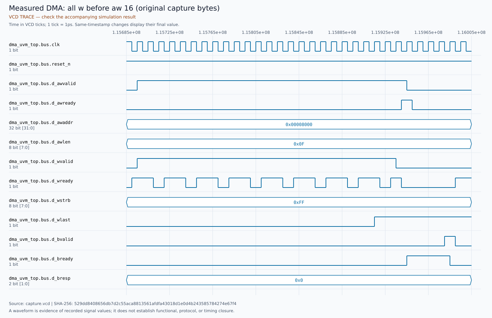

# Measured DMA public-pin waveforms

These eight figures use actual samples from the final functional simulation.
They are not expected diagrams or independent pass/fail evidence. The scoreboards,
assertion controls and accounting in [SUMMARY.md](SUMMARY.md) determine the result.
All captures retain their original bytes with Git `-text`.

| Measured figure | Metadata (same directory) |
| --- | --- |
| [aw_first.svg](waveforms/aw_first.svg) | `aw_first.json` |
| [w_first.svg](waveforms/w_first.svg) | `w_first.json` |
| [all_w_before_aw_16.svg](waveforms/all_w_before_aw_16.svg) | `all_w_before_aw_16.json` |
| [same_edge_aw_w_2.svg](waveforms/same_edge_aw_w_2.svg) | `same_edge_aw_w_2.json` |
| [destination_page_split.svg](waveforms/destination_page_split.svg) | `destination_page_split.json` |
| [read_error_middle.svg](waveforms/read_error_middle.svg) | `read_error_middle.json` |
| [reset_commit_before_b.svg](waveforms/reset_commit_before_b.svg) | `reset_commit_before_b.json` |
| [reset_control_aw_only.svg](waveforms/reset_control_aw_only.svg) | `reset_control_aw_only.json` |

The [manifest](waveforms/MANIFEST.json) and each adjacent JSON file record the
exact tick window (1 ps per tick), source SHA-256, public-pin events and renderer
hashes. The [raw functional VCD](run/functional/capture.vcd) has SHA-256
`529dd8408656db7d2c55aca8813561afdfa43018d1e0d4b243585784274e67f4`.

The destination-boundary figure annotates the actual accepted AW addresses and
final WSTRB in its title; a narrow interval may not have room for its bus-value
label. The reset figure shows complete AW/W followed by reset before B: memory
retention is checked by the independent scoreboard, not inferred from the plot.

## Example: all sixteen W beats before AW

The manifest records the observed first/last W and AW acceptance edges. Other
figures show address-first, data-first, same-edge AW/first-W, boundary/tail,
legal read error and partial-control reset. Same-timestamp transitions are
collapsed by the renderer; this is not delta-cycle, coverage or timing signoff.
