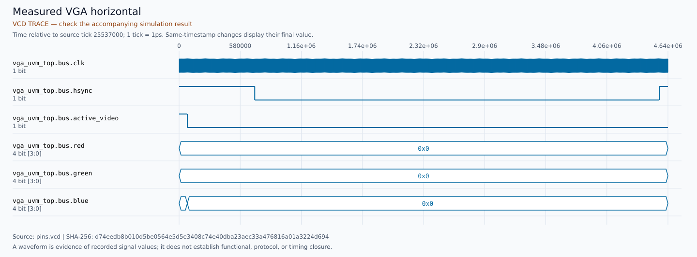
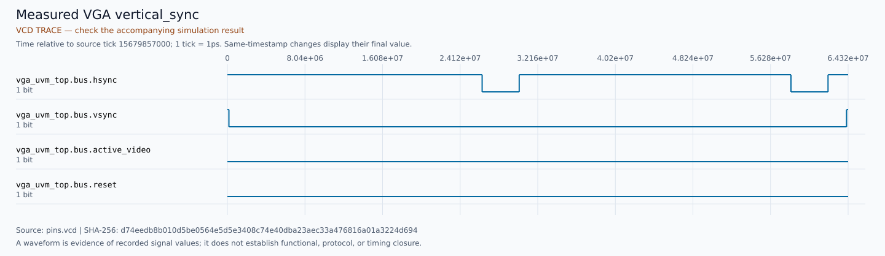
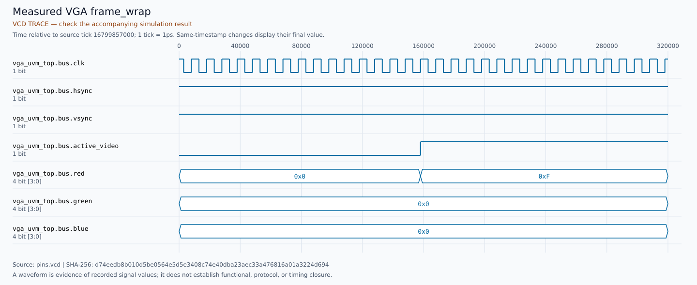
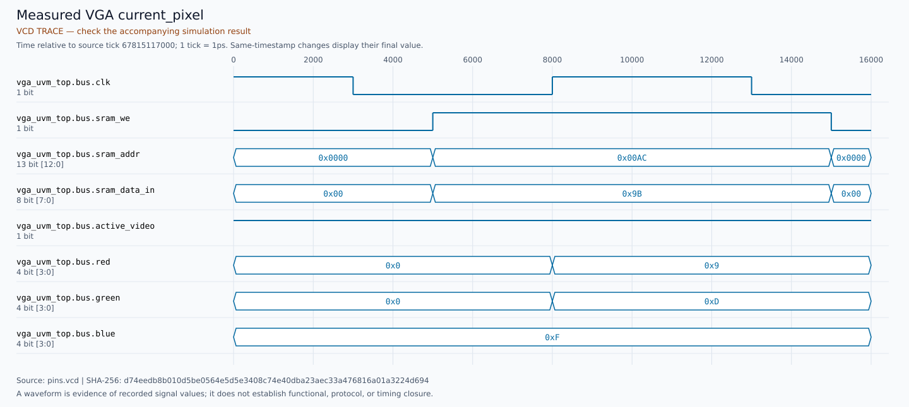
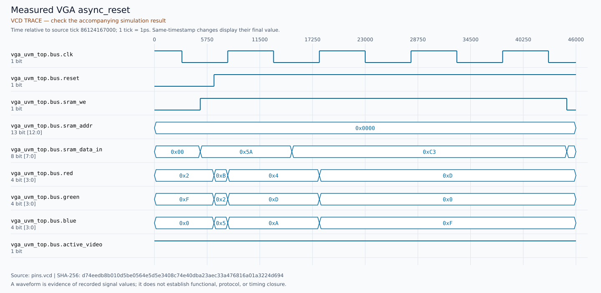

# Deterministic VGA timing/framebuffer UVM/SVA — review package

**Executed: 37/37 named required substeps PASS; aggregate
and actual outer wrapper exits 0.** These are a separate bounded milestone's
results; technical PRs remain open for review. The completed portfolio releases
and their runners/inventories/locks are unchanged.

## Exact identities and tools

| Item | Exact tested identity |
| --- | --- |
| Fresh detached GitHub environment | `3afa2912076b6e7dadf6c958d444e2dc9a2a87f4` |
| Runner last-change | `20c9eaa4d79209fb46323451be0783f1d8fe6df2` |
| Inventory last-change | `20c9eaa4d79209fb46323451be0783f1d8fe6df2` |
| Unchanged production VGA source lock / observed source | `8e257d11b1964fe82d4d4f3c3192b6a315d3b93d` |
| Simulator | Questa Altera Starter FPGA Edition-64 vsim 2025.2 Simulator 2025.05 May 31 2025 |
| UVM runtime | QUESTA_UVM-1.2.3 |
| UVM seed | 0x28A6BEEF / 682016495 |

Owner CLI/API verified M-Roohan-Khan-28, immutable ID 270144410. Work used
isolated branches and owner credentials; no hassamhk owner write occurred.
[Source/input fingerprints](SOURCE_LOCKS.json), [source receipts](source-receipts/fresh-source.json),
[actual commands/JSON](run/results.json), [outer wrapper](wrapper.json),
[validation](VALIDATION.json) and [command-log hash audit](COMMAND_HASH_AUDIT.json)
record the real execution. Source and DUT worktrees remained clean; all full
SHAs and execution-file fingerprints matched. Later documentation/evidence
commits retain these execution inputs.

Questa prints the counted `vopt-10908` warning from `+acc`, plus a separate
`onerror` warning. Raw logs preserve both. Positive UVM runs have no UVM error,
fatal or unexpected assertion detection. No production RTL fix was required.

## Implemented contract and independent checking

The [frozen contract and requirements matrix](../../docs/DETERMINISTIC_VGA_UVM.md)
describe 80×60 RGB332 storage, 13-bit writes with valid range 0–4799, ignored
4800–8191, raster-only asynchronous reset with retained memory and allowed
clocked writes, divide-by-four progression, 800×525 raster, 640×480 active
video, HSYNC 656–751 and VSYNC 490–491, 8×8 replication and RGB expansion.
There is no external SRAM port or write handshake. The source's three-band
background and DIL artwork remain unchanged.

Real sequence/sequencer/driver/passive monitor/reference models/scoreboard/
environment/test components execute deterministic transactions. Raster and
framebuffer models are separate, derived only from public clocks, reset,
specified initialization and observed writes. Neither reads private DUT state
or resynchronizes to HSYNC/VSYNC. Every rising clock and input-change
observation receives six pin-group checks after settlement. Pure concurrent
assertions compress duplicate constant signatures; changed expected or actual
pins, resets, control events and writes are always eligible. Assertion samples
and functional observations are separate counts.

Intended controls travel on a separate UVM analysis path and are recorded in
`intents.csv`; observed enabled edges are in `accepted-writes.csv`. Independent
Python interval checking reconciles every timestamp/address/data/enable window,
valid/ignored classification, reset overlap and held-enable edge. These are
public contract write events; no claim is made to observe an idempotent
internal memory operation. No unconditional four-clock RGB stability is imposed.

## Complete required inventory

| Named entry | Result | Meaning |
| --- | --- | --- |
| `runner-qualification` | PASS | SYNTHETIC_RECORD_FIXTURES |
| `sva-hsync` | PASS | EXECUTED |
| `sva-vsync` | PASS | EXECUTED |
| `sva-active` | PASS | EXECUTED |
| `sva-blank` | PASS | EXECUTED |
| `sva-rgb` | PASS | EXECUTED |
| `sva-reset` | PASS | EXECUTED |
| `sva-legal_reset_write` | PASS | EXECUTED |
| `sva-legal_reset_nonblack` | PASS | EXECUTED |
| `sva-legal_current_write` | PASS | EXECUTED |
| `sva-legal_inactive_inputs` | PASS | EXECUTED |
| `smoke` | PASS | EXECUTED |
| `functional` | PASS | EXECUTED |
| `control-framewrap` | PASS | EXECUTED |
| `control-horizontal` | PASS | EXECUTED |
| `control-intent` | PASS | EXECUTED |
| `control-invalid` | PASS | EXECUTED |
| `control-phase` | PASS | EXECUTED |
| `control-scale` | PASS | EXECUTED |
| `control-vertical` | PASS | EXECUTED |
| `control-row` | PASS | EXECUTED |
| `fault-hsync` | PASS | EXPECTED_CHILD_FAILURE |
| `fault-vsync` | PASS | EXPECTED_CHILD_FAILURE |
| `fault-frame_wrap` | PASS | EXPECTED_CHILD_FAILURE |
| `fault-divider` | PASS | EXPECTED_CHILD_FAILURE |
| `fault-scale` | PASS | EXPECTED_CHILD_FAILURE |
| `fault-row_stride` | PASS | EXPECTED_CHILD_FAILURE |
| `fault-rgb` | PASS | EXPECTED_CHILD_FAILURE |
| `fault-blank` | PASS | EXPECTED_CHILD_FAILURE |
| `fault-invalid_alias` | PASS | EXPECTED_CHILD_FAILURE |
| `fault-clear_reset` | PASS | EXPECTED_CHILD_FAILURE |
| `fault-disabled_reset_write` | PASS | EXPECTED_CHILD_FAILURE |
| `fault-gated_write` | PASS | EXPECTED_CHILD_FAILURE |
| `fault-driver_alias` | PASS | EXPECTED_CHILD_FAILURE |
| `fault-missing_marker` | PASS | EXPECTED_CHILD_FAILURE |
| `portable` | PASS | EXECUTED |
| `measured-evidence` | PASS | ACTUAL_PIN_EVIDENCE |

**49 synthetic runner-record fixtures** qualify the actual production
predicate and write-window reconciliation. Altered records cover abnormal tool
exits, timeouts, incomplete commands, stale output, wrong source/input identity,
missing/wrong/extra diagnostics and invalid write receipts. These are fixtures,
not induced simulator crashes. **Ten synthetic SVA controls** comprise six
individually identified negative detections and four legal controls for writes
during reset, nonblack reset RGB, current-pixel RGB changes and inactive inputs.

## Principal real-DUT outcomes

**30 principal named scenarios**, plus
**8 unmodified fault-control scenarios**, executed.
The principal smoke/shared raster groups measured:

```text
8,612,680 rising input clocks; 8,622,612 settled observations
51,735,672 comparisons = 6 x 8,622,612 observations
9896 enabled write edges = 9882 valid + 14 ignored
2,150,691 raster advances; 2,150,693 once-per-pixel samples
1,599,152 active samples; 2687 complete lines; 4 complete frames
```

Two initial uninterrupted frames precede any framebuffer replacement pattern.
Each low/high address pattern scan checks all **4,800** entries through actual
outputs, with 420,000 raster samples, 307,200 active samples, 50,400 HSYNC-low
and 1,600 VSYNC-low samples per complete scan. The pattern pair distinguishes
all 13 address bits. Invalid writes are checked through the following scan
before any valid overwrite can hide their effects. The direct RGB case observes
all **256** values. The directed phase case records one write at each pre-edge
divider phase. Reset, active/blank writes, pending/current/future cells,
retention and release checks are named below. Counts include partial intervals
around reset and are not coverage percentages.

| Principal scenario | Input clocks | Observations | Comparisons | Valid / ignored writes | Completed frames |
| --- | --- | --- | --- | --- | --- |
| `smoke` | 85 | 89 | 534 | 2 / 0 | 0 |
| `initial_image` | 2 | 4 | 24 | 0 / 0 | 0 |
| `horizontal_boundaries` | 3,016 | 3,016 | 18,096 | 0 / 0 | 0 |
| `line_wrap` | 200 | 200 | 1,200 | 0 / 0 | 0 |
| `vertical_active_boundary` | 1,532,800 | 1,532,800 | 9,196,800 | 0 / 0 | 0 |
| `vertical_sync_boundaries` | 38,400 | 38,400 | 230,400 | 0 / 0 | 0 |
| `frame_wrap` | 105,600 | 105,600 | 633,600 | 0 / 0 | 1 |
| `consecutive_second_frame` | 1,679,984 | 1,679,984 | 10,079,904 | 0 / 0 | 1 |
| `pattern_low_load` | 4,800 | 9,601 | 57,606 | 4800 / 0 | 0 |
| `invalid_low_sideeffects` | 8 | 16 | 96 | 0 / 7 | 0 |
| `pattern_low_scan` | 1,680,001 | 1,680,002 | 10,080,012 | 0 / 0 | 1 |
| `pattern_high_load` | 4,800 | 9,601 | 57,606 | 4800 / 0 | 0 |
| `invalid_high_sideeffects` | 8 | 16 | 96 | 0 / 7 | 0 |
| `pattern_high_scan` | 1,680,001 | 1,680,002 | 10,080,012 | 0 / 0 | 1 |
| `all_rgb332` | 256 | 513 | 3,078 | 256 / 0 | 0 |
| `back_to_back_edges` | 5 | 10 | 60 | 4 / 0 | 0 |
| `held_enable` | 5 | 7 | 42 | 4 / 0 | 0 |
| `inactive_input_changes` | 4 | 6 | 36 | 0 / 0 | 0 |
| `divider_phase_writes` | 20 | 29 | 174 | 4 / 0 | 0 |
| `current_previous_future` | 308,498 | 308,505 | 1,851,030 | 3 / 0 | 0 |
| `horizontal_blanking_write` | 3,232 | 3,234 | 19,404 | 1 / 0 | 0 |
| `active_reset` | 83 | 87 | 522 | 0 / 0 | 0 |
| `hsync_reset` | 2,641 | 2,643 | 15,858 | 0 / 0 | 0 |
| `vertical_blanking_write_and_sync_reset` | 1,568,053 | 1,568,058 | 9,408,348 | 2 / 0 | 0 |
| `asynchronous_pending_write` | 1 | 3 | 18 | 1 / 0 | 0 |
| `held_reset_writes` | 3 | 5 | 30 | 3 / 0 | 0 |
| `coincident_reset_write` | 3 | 5 | 30 | 2 / 0 | 0 |
| `release_first_four_clocks` | 5 | 6 | 36 | 0 / 0 | 0 |
| `repeated_reset_retention` | 6 | 10 | 60 | 0 / 0 | 0 |
| `post_reset_operation` | 160 | 160 | 960 | 0 / 0 | 0 |

## Real fault qualifications

| Disposable fault | Exact primary condition | Exact SVA set | Child wrapper | vlib / vlog / vsim | Parent |
| --- | --- | --- | --- | --- | --- |
| `fault-hsync` | `VGA_HSYNC` | HSYNC | 1 | 0 / 0 / 0 | PASS |
| `fault-vsync` | `VGA_VSYNC` | VSYNC | 1 | 0 / 0 / 0 | PASS |
| `fault-frame_wrap` | `VGA_ACTIVE` | ACTIVE, BLANK | 1 | 0 / 0 / 0 | PASS |
| `fault-divider` | `VGA_RGB` | RGB | 1 | 0 / 0 / 0 | PASS |
| `fault-scale` | `VGA_RGB` | RGB | 1 | 0 / 0 / 0 | PASS |
| `fault-row_stride` | `VGA_RGB` | RGB | 1 | 0 / 0 / 0 | PASS |
| `fault-rgb` | `VGA_RESET` | RESET | 1 | 0 / 0 / 0 | PASS |
| `fault-blank` | `VGA_BLANK` | BLANK | 1 | 0 / 0 / 0 | PASS |
| `fault-invalid_alias` | `VGA_RESET` | RESET | 1 | 0 / 0 / 0 | PASS |
| `fault-clear_reset` | `VGA_RESET` | RESET | 1 | 0 / 0 / 0 | PASS |
| `fault-disabled_reset_write` | `VGA_RESET` | RESET | 1 | 0 / 0 / 0 | PASS |
| `fault-gated_write` | `VGA_RGB` | RGB | 1 | 0 / 0 / 0 | PASS |
| `fault-driver_alias` | `VGA_INTENT` | none | 1 | 0 / 0 / 0 | PASS |
| `fault-missing_marker` | `MISSING_RESULT_MARKER` | none | 1 | 0 / 0 / 0 | PASS |

Every parent retains a corresponding passing unmodified control. The child
must fail with exit 1 while all three tools succeed with exit 0, no timeout,
the exact diagnostic set, nonce and source/input identities. Wrong diagnostics,
crashes and compile failures do not qualify. `frame_wrap` deliberately yields
both ACTIVE and BLANK detections; reset-held output faults use the exclusive
RESET property. This precise policy is frozen in inventory. Original sources
are never mutated; disposable RTL/shim inputs and their diffs/hashes remain
with each child. Missing-marker qualification retains genuine HDL completion.

## Existing portable gate

The locked `scripts/run_regression.ps1` passed **7 legacy checks**, **8 reset-edge
temporal checks**, and **29,588,940 raster comparisons**, all simulator exits 0
and wrapper exit 0. Its separate ModelSim Intel FPGA Starter 2020.1 version,
deterministic exhaustive-byte stimulus and exact commands are in
`run/portable/run/results.json`. No obsolete launcher was substituted.

## Measured visual evidence

The following image is a **simulation-reconstructed frame**, produced from
420,000 recorded actual R4/G4/B4/HS/VS/active samples. It is not a monitor
photograph or FPGA demonstration. Sampling uses the first input clock per
raster pixel, output at +1 ns; each observed 4-bit channel is multiplied by 17.
The PNG is generated from actual output bytes, never reference memory.


[Raw pixel stream](run/functional/actual-frame.rgb444),
[frame metadata](run/measured-evidence/figures/simulation-reconstructed-frame.json),
[actual decoded initialization/signature](run/measured-evidence/figures/initial-artwork-signature.json).
The image source hash is `1748eebde5f94c3faad5f3ab05d0007b0d7cb4540f85dcf7420869f8c0b1f1ef`; capture window is
26000–16799986000 ps. The separate specification
checksum only checks the measured initial atlas; it never supplies image pixels.

### horizontal

Measured public pins, functional test, ticks 25537000–30177000
(1 ps ticks), source `3afa2912076b6e7dadf6c958d444e2dc9a2a87f4`. Original capture SHA-256
`d74eedb8b010d5be0564e5d5e3408c74e40dba23aec33a476816a01a3224d694`. [Raw VCD](run/functional/pins.vcd) and
[figure metadata](run/measured-evidence/figures/horizontal.json).



### vertical_sync

Measured public pins, functional test, ticks 15679857000–15744177000
(1 ps ticks), source `3afa2912076b6e7dadf6c958d444e2dc9a2a87f4`. Original capture SHA-256
`d74eedb8b010d5be0564e5d5e3408c74e40dba23aec33a476816a01a3224d694`. [Raw VCD](run/functional/pins.vcd) and
[figure metadata](run/measured-evidence/figures/vertical_sync.json).



### frame_wrap

Measured public pins, functional test, ticks 16799857000–16800177000
(1 ps ticks), source `3afa2912076b6e7dadf6c958d444e2dc9a2a87f4`. Original capture SHA-256
`d74eedb8b010d5be0564e5d5e3408c74e40dba23aec33a476816a01a3224d694`. [Raw VCD](run/functional/pins.vcd) and
[figure metadata](run/measured-evidence/figures/frame_wrap.json).



### current_pixel

Measured public pins, functional test, ticks 67815117000–67815133000
(1 ps ticks), source `3afa2912076b6e7dadf6c958d444e2dc9a2a87f4`. Original capture SHA-256
`d74eedb8b010d5be0564e5d5e3408c74e40dba23aec33a476816a01a3224d694`. [Raw VCD](run/functional/pins.vcd) and
[figure metadata](run/measured-evidence/figures/current_pixel.json).



### async_reset

Measured public pins, functional test, ticks 86124167000–86124213000
(1 ps ticks), source `3afa2912076b6e7dadf6c958d444e2dc9a2a87f4`. Original capture SHA-256
`d74eedb8b010d5be0564e5d5e3408c74e40dba23aec33a476816a01a3224d694`. [Raw VCD](run/functional/pins.vcd) and
[figure metadata](run/measured-evidence/figures/async_reset.json).



Vector displays group recorded public scalar bits MSB first. Metadata records
that display transformation; the original VCD bytes remain untouched.
[Capture manifest](CAPTURE_MANIFEST.json) identifies original/committed hashes;
report-scoped `** -text` preserves capture bytes deliberately, including CRLF.
[Byte audit](BYTE_AUDIT.json) checks Git blobs, fresh checkout representations
and public raw capture downloads. Newline-only differences are not simulation
behavior changes. Proprietary tool/library files are excluded.

## Earlier attempts, reproduction and limits

The `attempts/` directories retain each earlier source, actual wrapper status,
raw logs and partial outcomes. The first smoke failed because concurrent
assertions sampled previous expectations in the same time slot; actual output
sampling stayed at +1 ns when corrected. The first full prototype was manually
interrupted for scheduling optimization and is **incomplete/FAIL**, wrapper 1,
not fault-detection proof or a passing milestone. Bounds were not increased to
turn that attempt into PASS. Later passing runs are separate.

[Tested ordinary-clone reproduction](REPRODUCE.md) explicitly detaches `3afa2912076b6e7dadf6c958d444e2dc9a2a87f4`
and runs one command, including rendering. Earlier portfolio/APB/AXI4-Lite/DMA/
AHB/cache releases, licences, attribution and reports are preserved; shared
execution inputs remain unchanged, so no unrelated environment was rerun.

**NOT RUN:** functional coverage, constrained randomization and the preserved
licence-blocked original advanced ALU/APB environments. These are procedural
bounded tests, not coverage closure. External SRAM, physical display compatibility,
board clocks/pixel frequency/refresh guarantees, new resolutions, double
buffering, synthesis, timing, FPGA and hardware remain separate milestones.
No mandatory deterministic execution blocker remains. PRs remain open for review.

## Published exact-byte audit

Content revision `7390295cdd680794c3628d543c4d32026e937a47` matched **1035 report files**, including
**1027 captured artifacts**, against Git blobs and fresh
detached checkouts with core.autocrlf=false and true. **203 public
raw downloads** matched, including **60 VCDs**, pixel streams,
write CSVs, measured figures and frame PNGs. Five current waveform metadata
records and the frame/artwork hashes matched their source captures. The audit
receipt is appended separately from the content revision it verifies.

The first byte-audit attempt verified the autocrlf=false checkout but then
stopped with a local disk-full error while recording the second clone command.
It is not a passing audit or an HDL failure. Only this task's generated simulator
work libraries were removed; raw logs, captures and source checkouts were kept.
The clean first checkout was reverified, and a new autocrlf=true clone was used
for this completed audit. See byte-audit-logs/byte-audit-disk-full.json.
